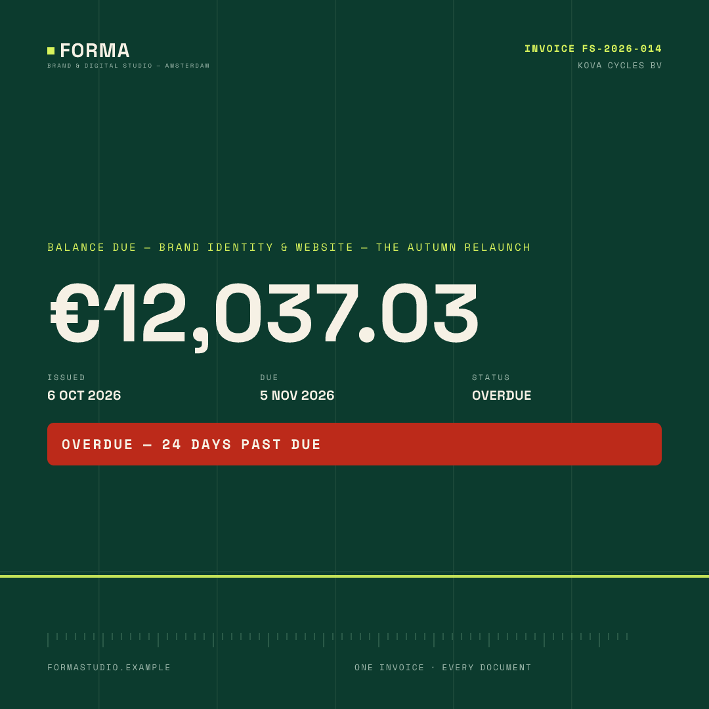
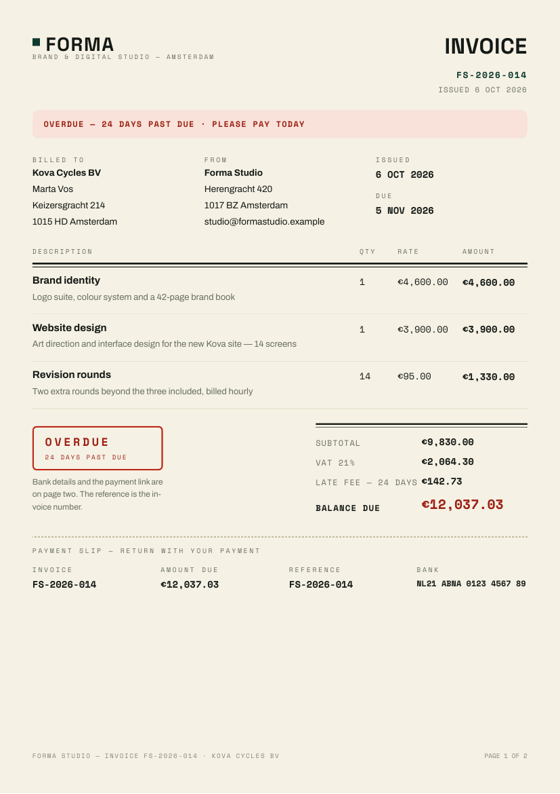
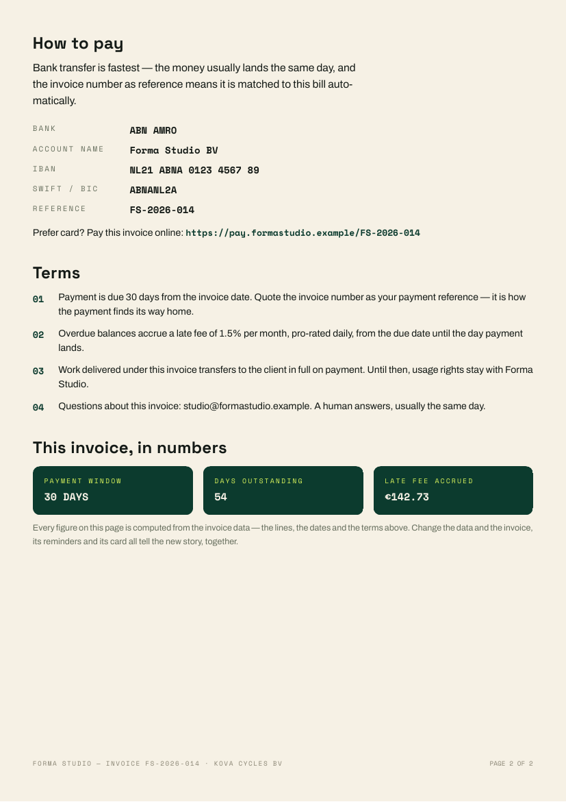
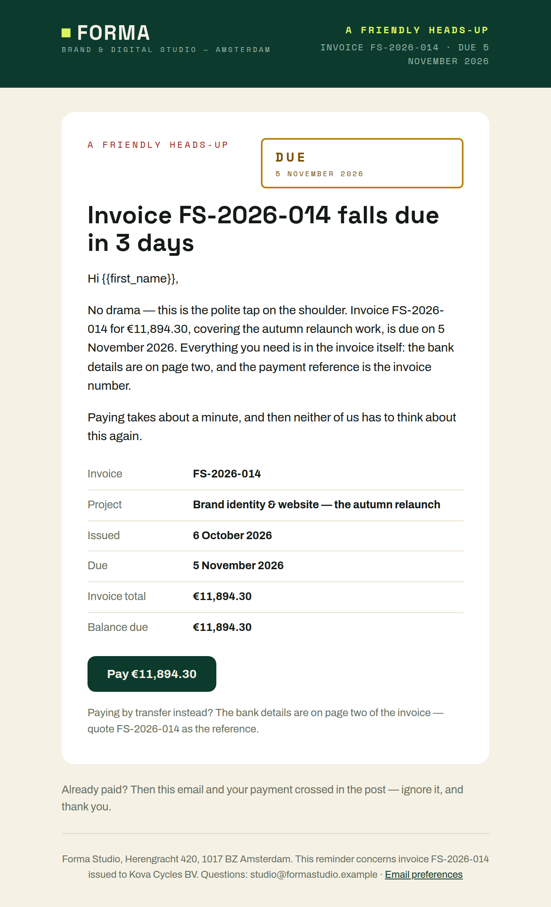
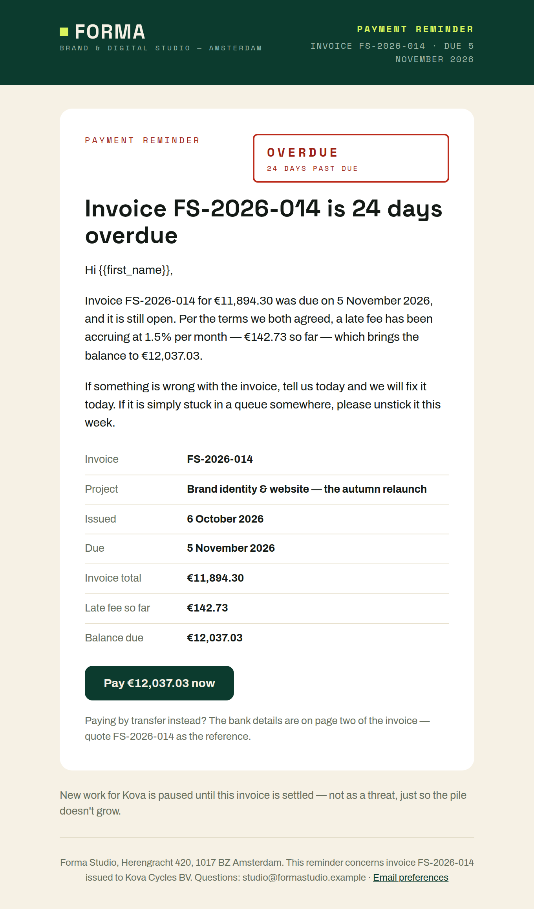
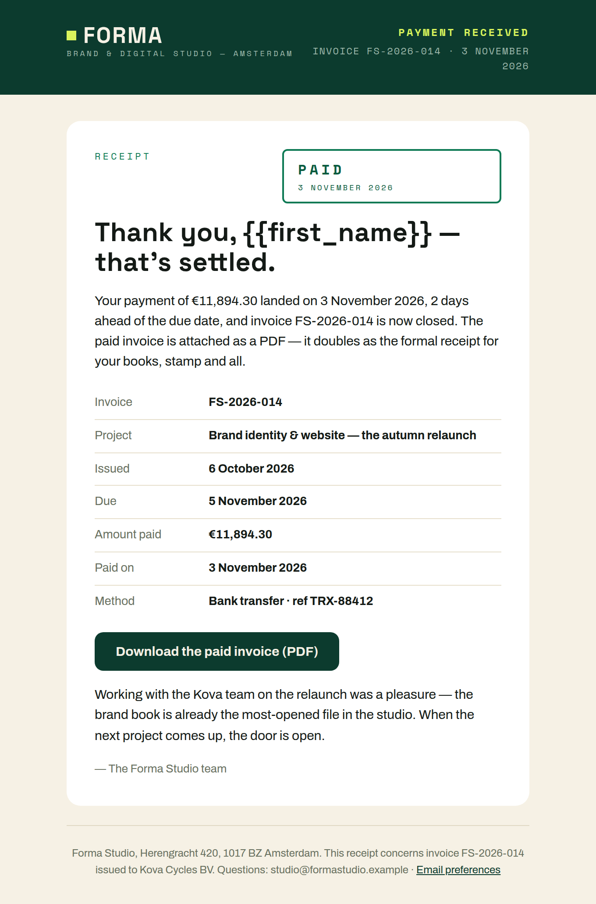
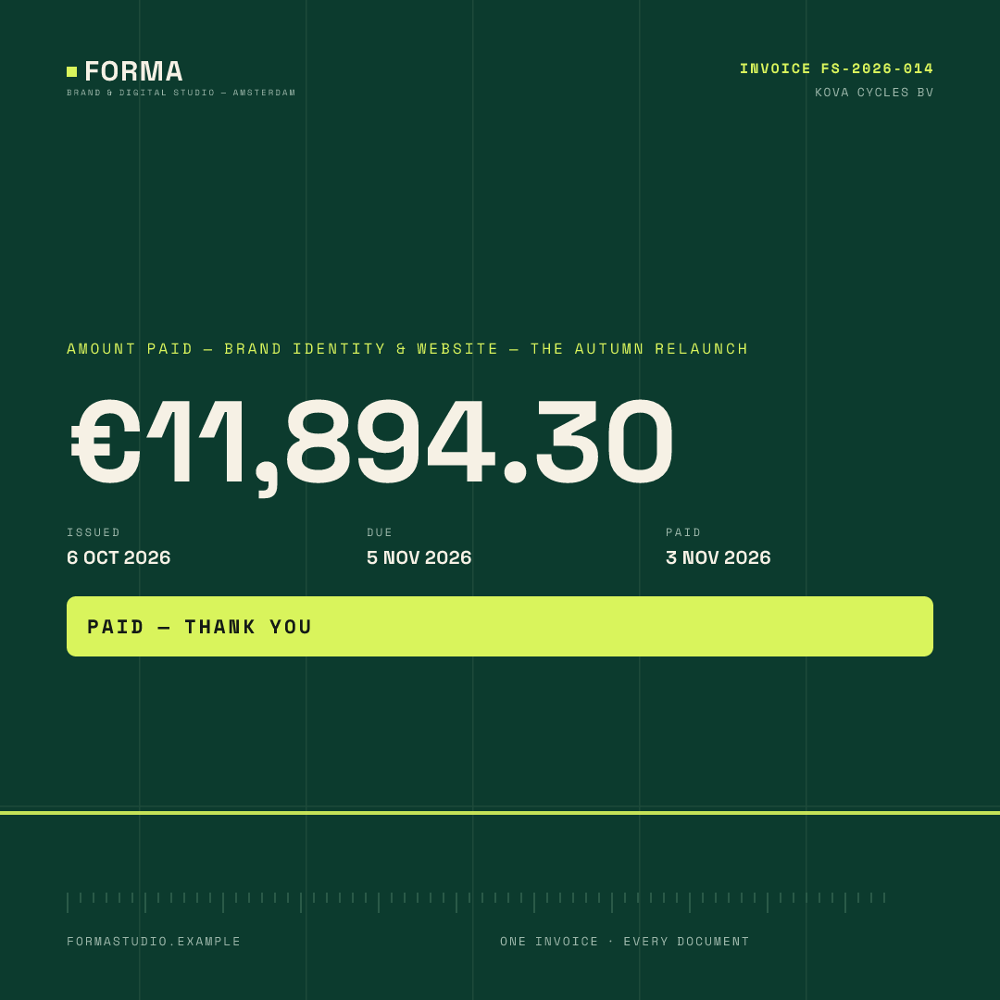

# Ledgerline — the get-paid kit for freelance studios

**One invoice, one data file, one theme — every document the invoice needs.** The invoice PDF (Document), the payment-reminder email (Email), the paid receipt email (Email) and a shareable summary card (Canvas), all rendered from a single invoice in `src/invoice.ts`, all sharing one `defineTheme`. Nothing in any output is a hard-coded total: line totals, VAT, the late fee, the status and even the reminder's tone are computed from the data by `src/ledger.ts`.

Built for the [Hyper Elements Template Challenge](https://github.com/hyper-elements/hyper-elements/discussions).



## The job

A freelance studio's least favourite admin task is chasing an invoice. Ledgerline is the whole chase, as templates: Forma Studio (a fictional Amsterdam brand studio) bills Kova Cycles for a rebrand, and the kit follows that one invoice through its life —

| Template | Root | Output | What it's for |
| --- | --- | --- | --- |
| [`src/invoice-doc.tsx`](src/invoice-doc.tsx) | `Document` A4, 2 pages | `out/invoice-{due,overdue,paid}.pdf` | The invoice itself, with bank details, terms and a tear-off payment slip |
| [`src/reminder.tsx`](src/reminder.tsx) | `Email` 600px | `out/reminder-{due,overdue,final}.html/.txt` | The reminder ladder — one template, three voices (below) |
| [`src/receipt.tsx`](src/receipt.tsx) | `Email` 600px | `out/receipt-paid.html/.txt` | The thank-you + payment summary sent when the money lands |
| [`src/card.tsx`](src/card.tsx) | `Canvas` 1080×1080 | `out/card-{due,overdue,paid}.png` | The summary card that travels with the PDF |

## The invoice is computed, not written

`src/ledger.ts` is the kit's judgement. Feed it an invoice and it returns the lines with their totals (qty × rate), the subtotal, VAT at the data's rate, the grand total — €9,830.00 + €2,064.30 = €11,894.30 for the sample invoice — plus everything the calendar implies:

- **Status.** `paidOn` set → PAID. `today` past `dueOn` → OVERDUE, with the day count. Otherwise DUE, with the countdown. The status drives the coloured strip across the invoice, the rubber stamp, the card's pill and the emails' header — one decision, four surfaces.
- **Late fee.** 1.5% per month, pro-rated daily, exactly as the invoice's own terms state: €142.73 at 24 days overdue, €267.62 at 45. It appears in the totals, the summary tables and the reminder copy — and the balance everyone quotes is total + fee.
- **Reminder tone.** The same ladder real studios climb, picked by days overdue: a **friendly heads-up** before the due date ("No drama — this is the polite tap on the shoulder"), a **firm reminder** at 8–27 days (fee itemised, new work paused), a **final notice** at 28+ (seven days, then collections). One `ReminderEmail` template renders all three; only the data's `today` changes.




## Two moments of the same invoice

The repo renders the sample invoice at four moments — due in 3 days, 24 days overdue, 45 days overdue, and paid two days early — because that spread is the proof: same data file, same templates, and every surface retells the story. The stamp flips from DUE to OVERDUE to PAID, the totals grow a late-fee line and lose it again, the reminder changes its voice, the card changes its pill.






## How Hyper Elements is used

- **One theme, four roots.** [`src/theme.ts`](src/theme.ts) is a single `defineTheme` — deep pine and warm cream, a lime that only appears on the green, a shared status palette (gold due / red overdue / green paid), Space Grotesk display + Archivo text + Space Mono figures — passed to the `Document`, both `Email`s and the `Canvas` alike. Templates pull colours with `token("colors.pine")`; nothing is hard-coded twice.
- **Shared components across formats.** [`src/components.tsx`](src/components.tsx) holds the wordmark, the two-line rubber stamp, the status strip, the totals block, the emails' summary table and the accounting double rule (a thick line over a hairline — the kit's motif). All of it is plain layout and type, no `Svg`, so every piece survives every root, email included. The one piece of `Svg` artwork — the card's ledger-column grid — lives on the Canvas, where `Svg` belongs.
- **A Document that paginates.** `PageBreak`, `PageFooter` with `PageNumber` / `PageNumber total`, a dashed perforation and tear-off payment slip on page one; page two is the part clients actually re-open: bank details, the four terms, and the invoice's vital statistics (payment window, days outstanding, fee accrued — all computed).
- **Email, done properly.** Merge-tag personalisation (`first_name`), a `Table` summary in every email, a themed `Button` whose label is the computed amount ("Pay €12,037.03 now"), and validation with the `@hyper-elements/email-clients` plugin — `render.tsx` also writes per-client previews (Gmail, Apple Mail, Outlook…) into `out/clients/`. The design is colour bands, stamps and rules, so it holds up with images off.
- **Prop-driven templates.** Every template takes the invoice as a prop (with a default, so the CLI check can read it bare) and renders from the computed view — the same pattern whether the moment is due, overdue or paid.
- **One render pipeline.** [`render.tsx`](render.tsx) validates all four templates (the emails with the email-clients plugin), then renders every output — `render()` for the emails and print HTML, `renderPdf()` for the invoices, `renderImage()` for the cards — handing the PDF and image renderers the same font files as bytes. Any error diagnostic stops the build.
- **Clean checks.** `npm run check` (the Hyper Elements CLI) reports **0 errors, 0 warnings** across all four templates.

## Design

Deep pine green, warm cream, one lime accent; Space Grotesk for the studio's voice, Archivo for text, Space Mono for every figure that came off a ledger. Status is colour-coded at a glance — pale tinted strip and deep text on the invoice, so the coding never costs contrast. Small caps mono labels, double rules above totals, and a stamp instead of a badge, because this is paperwork that wants to look like it means business.

## Notes from building with the beta

Three things worth passing on, in case they help the team or the next builder:

- **Space Mono's capital N is drawn with a reversed diagonal** — that's Colophon's design, not a rendering bug (verified against the font file). At display sizes in a date ("5 NOV 2026") it reads as a typo, so the card sets its dates in Space Grotesk; the small mono dates elsewhere keep the font's character.
- **Space Grotesk ships as a variable font**, and the byte-based renderers want statics — the kit vendors 500/700 instances under `assets/fonts/`, generated from the variable file with fontTools (the WOFFs alongside are for the HTML font faces).
- **In the PDF renderer, a flex row's children size by content** — an early draft let the stamp column and the totals column overlap. The invoice now gives that row explicit widths, which renders identically in HTML and PDF. Relatedly, `justifyContent: "space-between"` isn't possible in email (the validator says so); the emails use a `flex: 1` column + right-hand element instead.

## Run it

```sh
npm install
npm run render    # validates everything, then writes out/
npm run check     # hyper-elements check on the four templates
npm run typecheck
npm run previews  # refresh preview/ email screenshots (needs a Chromium)
```

Outputs land in `out/`: three invoice PDFs (+ print HTML), three reminder emails and the receipt (HTML + plain text), three summary cards, and the emails' per-client previews in `out/clients/`.

**Make it your own invoice:** edit `src/invoice.ts` — the studio, the client, the lines, the dates — and re-run `npm run render`. Move `today` forward and watch the status flip, the fee accrue and the reminder change its tone. Swap the palette and fonts in `src/theme.ts` and the whole kit rebrands.

## Structure

```
src/
  invoice.ts     the invoice, the studio, the client — the single source of truth
  ledger.ts      the arithmetic and the judgement: totals, VAT, late fee, status, tone
  theme.ts       the Ledgerline brand as one defineTheme
  components.tsx wordmark, stamp, status strip, totals, summary table, double rule
  invoice-doc.tsx the invoice (Document root)
  reminder.tsx   the reminder ladder (Email root)
  receipt.tsx    the receipt (Email root)
  card.tsx       the summary card (Canvas root)
  fonts.ts       font faces for the HTML outputs
render.tsx       validate + render every output into out/
scripts/         shots.mjs — email screenshots for preview/
assets/fonts/    Space Grotesk, Archivo, Space Mono (WOFF for HTML, TTF for PDF/image)
preview/         the screenshots above
out/             rendered outputs (regenerated by npm run render)
```

## License

MIT — see [LICENSE](LICENSE). Fonts are Space Grotesk, Archivo and Space Mono (SIL Open Font License), via Fontsource.
